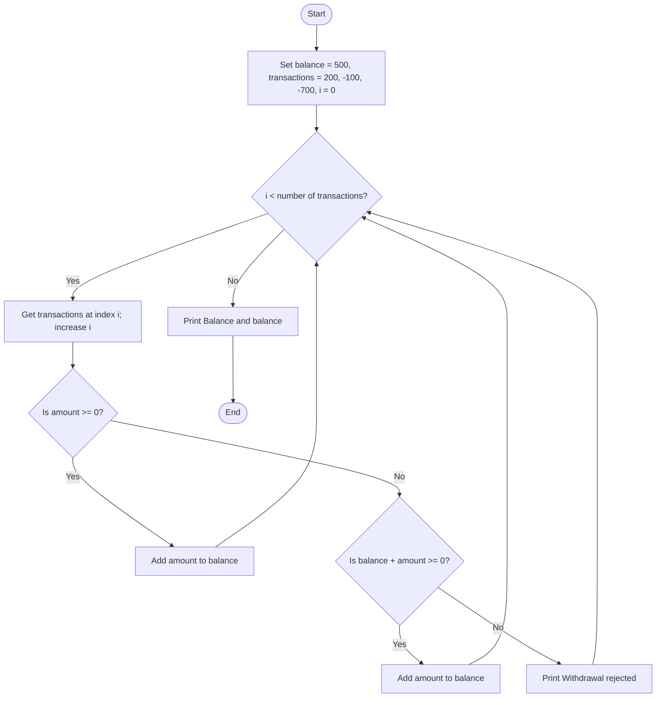

## Problem Statement
Write a Python program that processes a list of deposit and withdrawal transactions. Non-negative amounts are added to the balance. A withdrawal is processed only if it does not make the balance negative; otherwise, display "Withdrawal rejected". Finally, print the balance.

## Algorithm
1. Set the starting balance to 500.
2. Store the transactions in a list.
3. Set the index i to 0.
4. While i is less than the number of transactions:
   - Get the transaction at index i and increase i by 1.
   - If the amount is non-negative, add it to the balance.
   - Otherwise, if the withdrawal keeps the balance at or above zero, apply it.
   - Otherwise, display "Withdrawal rejected".
5. Print the final balance.

## Flowchart

## Pseudocode
START
    balance ← 500
    transactions ← [200, -100, -700]
    i ← 0

    WHILE i < LENGTH(transactions) DO
        amount ← transactions[i]
        i ← i + 1

        IF amount >= 0 THEN
            balance ← balance + amount
        ELSE IF balance + amount >= 0 THEN
            balance ← balance + amount
        ELSE
            DISPLAY "Withdrawal rejected"
        END IF
    END WHILE

    DISPLAY "Balance:", balance
END

## Sample Input
The values are set in the program:
Starting balance: 500
Transactions: 200, -100, -700
Sample Output
Withdrawal rejected
Balance: 600
