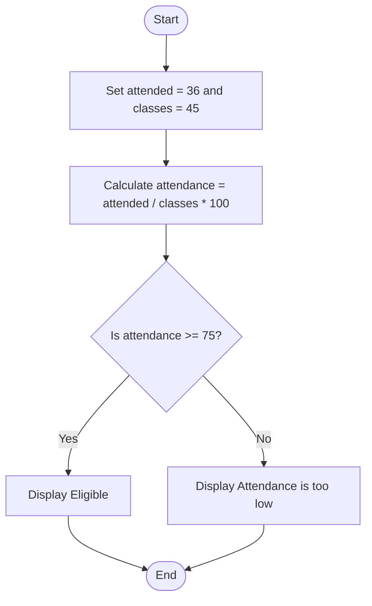

## Problem Statement
Write a Python program that calculates a student’s attendance percentage and checks whether they are eligible. A student is Eligible if their attendance is at least 75%; otherwise, display Attendance is too low.

## Algorithm
1. Set the number of attended classes to 36.
2. Set the total number of classes to 45.
3. Calculate the attendance percentage: attended / classes * 100.
4. If attendance is at least 75%, display "Eligible".
5. Otherwise, display "Attendance is too low".

## Flowchart

## Pseudocode
START
    attended ← 36
    classes ← 45
    attendance ← attended / classes * 100

    IF attendance >= 75 THEN
        DISPLAY "Eligible"
    ELSE
        DISPLAY "Attendance is too low"
    END IF
END

## Sample Input
The values are set in the program:
attended = 36
classes = 45
Sample Output
Eligible
