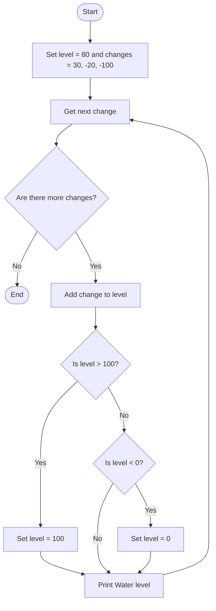

## Problem Statement
Write a Python program that updates a water level based on a sequence of changes. Keep the level within the range of 0 to 100, and print the level after each change.

## Algorithm
1. Set the initial water level to 80.
2. For each change in [30, -20, -100]:
   - Add the change to the water level.
   - If the level exceeds 100, set it to 100.
   - If the level is below 0, set it to 0.
   - Print the updated water level.

## Flowchart

## Pseudocode
START
    level ← 80
    changes ← [30, -20, -100]

    FOR EACH change IN changes DO
        level ← level + change

        IF level > 100 THEN
            level ← 100
        ELSE IF level < 0 THEN
            level ← 0
        END IF

        DISPLAY "Water level:", level
    END FOR
END

## Sample Input
The values are set in the program:
Initial water level: 80
Changes: 30, -20, -100
Sample Output
Water level: 100
Water level: 80
Water level: 0
