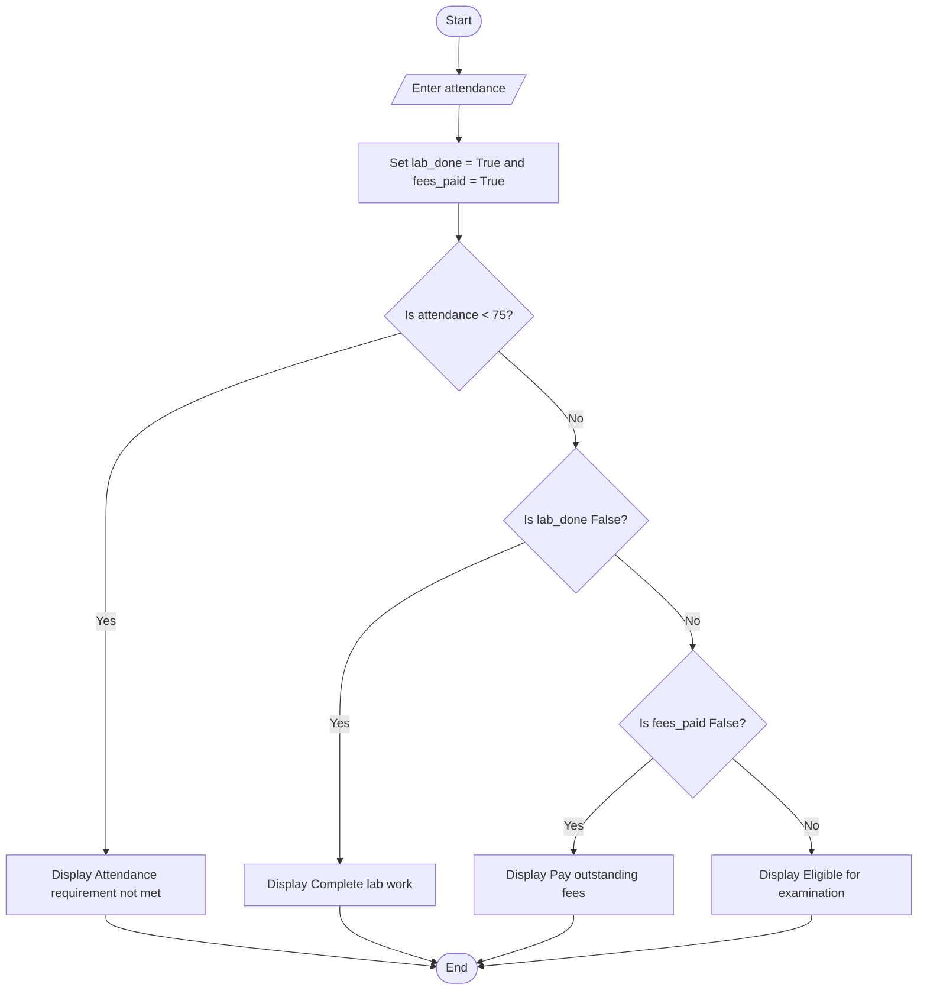

## Problem Statement
Write a Python program that checks whether a student is eligible to take an examination. The student must have attendance of at least 75%, completed lab work, and paid all fees. The program asks for the attendance percentage and checks the other two requirements.

## Algorithm
1. Ask the user to enter the attendance percentage.
2. Set lab_done and fees_paid to True.
3. If attendance is below 75%, display "Attendance requirement not met".
4. Otherwise, if lab work is not completed, display "Complete lab work".
5. Otherwise, if fees are not paid, display "Pay outstanding fees".
6. If all requirements are met, display "Eligible for examination".

## Flowchart

## Pseudocode
START
    INPUT attendance
    lab_done ← TRUE
    fees_paid ← TRUE

    IF attendance < 75 THEN
        DISPLAY "Attendance requirement not met"
    ELSE IF lab_done = FALSE THEN
        DISPLAY "Complete lab work"
    ELSE IF fees_paid = FALSE THEN
        DISPLAY "Pay outstanding fees"
    ELSE
        DISPLAY "Eligible for examination"
    END IF
END

## Sample Input
Enter the attendance: 80
Sample Output
Eligible for examination
