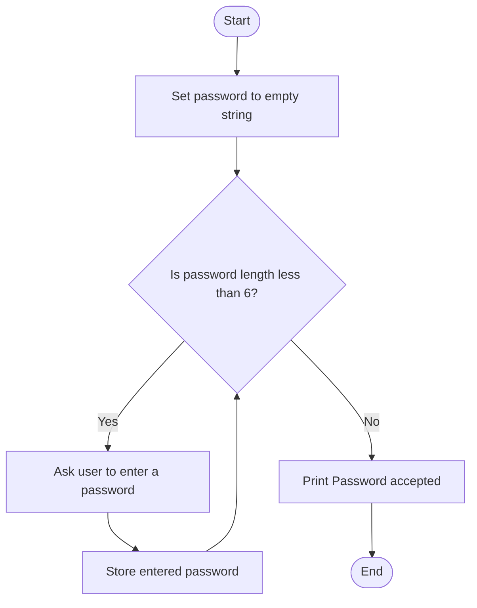

## Problem Statement
Write a Python program that asks the user to enter a password until it contains at least 6 characters. Once a valid password is entered, display "Password accepted".

## Algorithm
1. Set password to an empty string.
2. While the password has fewer than 6 characters:
   - Ask the user to enter a password.
3. When the loop ends, display "Password accepted".

## Flowchart

## Pseudocode
START
    password ← ""

    WHILE LENGTH(password) < 6 DO
        DISPLAY "Enter a password (at least 6 characters):"
        INPUT password
    END WHILE

    DISPLAY "Password accepted"
END

## Sample Input
abc
python123
Sample Output
Enter a password (at least 6 characters): abc
Enter a password (at least 6 characters): python123
Password accepted
