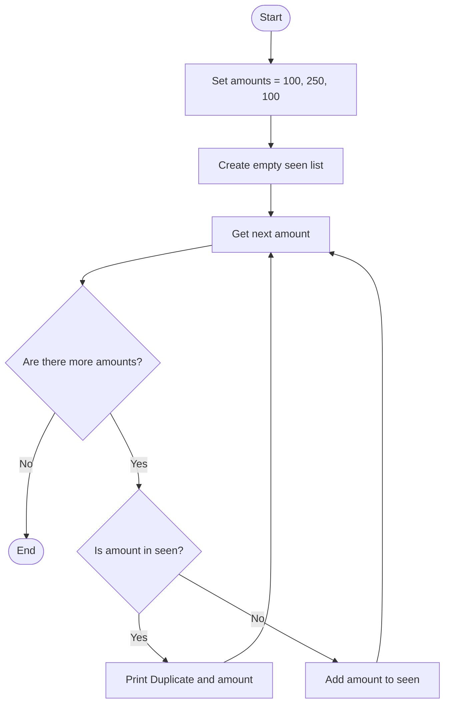

## Problem Statement
Write a Python program that checks a list of amounts for duplicates. When an amount has appeared earlier in the list, print "Duplicate:" followed by that amount.

## Algorithm
1. Set amounts to [100, 250, 100].
2. Create an empty list called seen.
3. For each amount in amounts:
   - If the amount is already in seen, print it as a duplicate.
   - Otherwise, add it to seen.

## Flowchart

## Pseudocode
START
    amounts ← [100, 250, 100]
    seen ← empty list

    FOR EACH amount IN amounts DO
        IF amount is in seen THEN
            DISPLAY "Duplicate:", amount
        ELSE
            ADD amount TO seen
        END IF
    END FOR
END

## Sample Input
The values are set in the program:
Amounts: 100, 250, 100
Sample Output
Duplicate: 100
