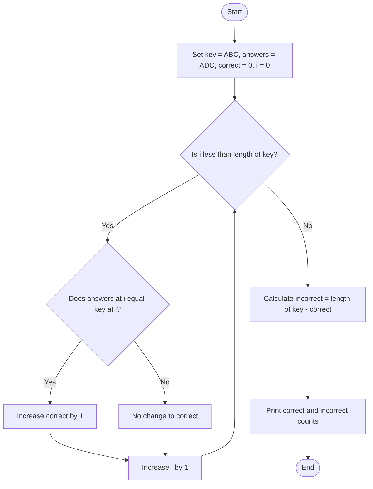

## Problem Statement
Write a Python program that compares a student's answers with an answer key. Count and display the number of correct and incorrect answers.

## Algorithm
1. Set the answer key to "ABC" and the student's answers to "ADC".
2. Set correct to 0.
3. For each position in the answer key:
   - Compare the student's answer with the answer key at that position.
   - If they match, increase correct by 1.
4. Calculate incorrect answers by subtracting correct from the length of the answer key.
5. Display the correct and incorrect counts.

## Flowchart

## Pseudocode
START
    key ← "ABC"
    answers ← "ADC"
    correct ← 0

    FOR i ← 0 TO LENGTH(key) - 1 DO
        IF answers[i] = key[i] THEN
            correct ← correct + 1
        END IF
    END FOR

    incorrect ← LENGTH(key) - correct

    DISPLAY "Correct:", correct
    DISPLAY "Incorrect:", incorrect
END

## Sample Input
The values are set in the program:
Answer key: ABC
Student answers: ADC
Sample Output
Correct: 2
Incorrect: 1
