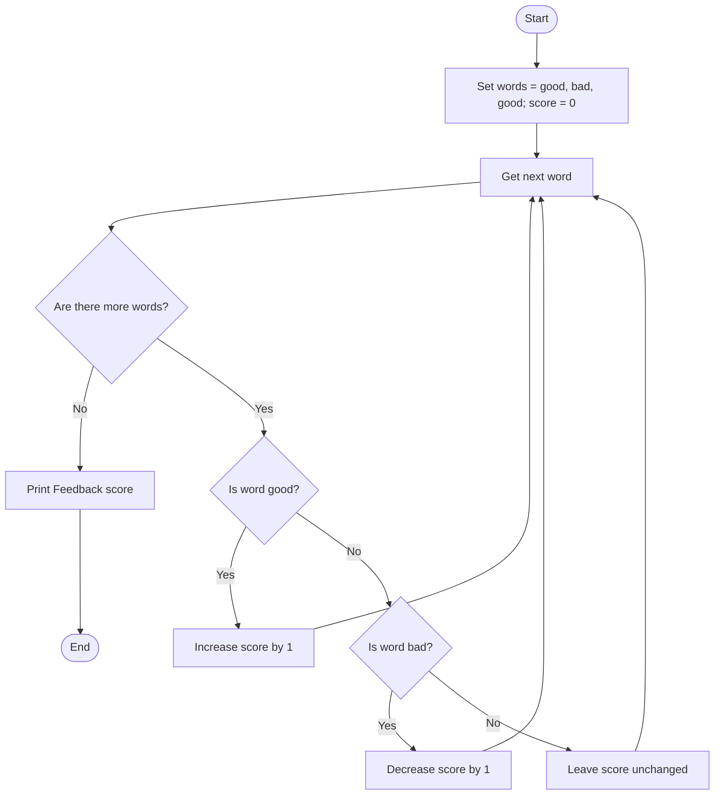

## Problem Statement
Write a Python program that calculates a feedback score from a list of words. Add 1 for each "good" and subtract 1 for each "bad", then display the total score.

## Algorithm
1. Set words to ["good", "bad", "good"].
2. Set score to 0.
3. For each word in the list:
   - If the word is "good", increase the score by 1.
   - If the word is "bad", decrease the score by 1.
4. Display the feedback score.

## Flowchart

## Pseudocode
START
    words ← ["good", "bad", "good"]
    score ← 0

    FOR EACH word IN words DO
        IF word = "good" THEN
            score ← score + 1
        ELSE IF word = "bad" THEN
            score ← score - 1
        END IF
    END FOR

    DISPLAY "Feedback score:", score
END

## Sample Input
The values are set in the program:
Words: good, bad, good
Sample Output
Feedback score: 1
