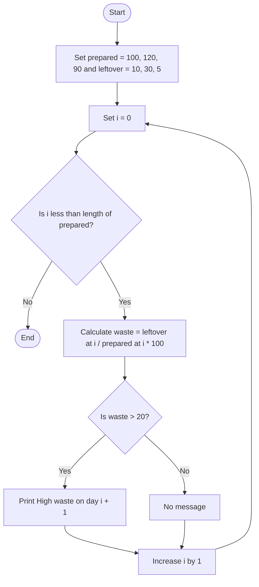

## Problem Statement
Write a Python program that calculates the percentage of leftover food for each day. If the waste percentage is greater than 20%, display which day had high waste.

## Algorithm
1. Store the food prepared each day in prepared.
2. Store the leftover food for each day in leftover.
3. For each day:
   - Calculate waste percentage as leftover / prepared * 100.
   - If the waste percentage is greater than 20%, display the day number.

## Flowchart

## Pseudocode
START
    prepared ← [100, 120, 90]
    leftover ← [10, 30, 5]

    FOR i ← 0 TO LENGTH(prepared) - 1 DO
        waste ← leftover[i] / prepared[i] * 100

        IF waste > 20 THEN
            DISPLAY "High waste on day", i + 1
        END IF
    END FOR
END

## Sample Input
The values are set in the program:
Prepared: 100, 120, 90
Leftover: 10, 30, 5
Sample Output
High waste on day 2
